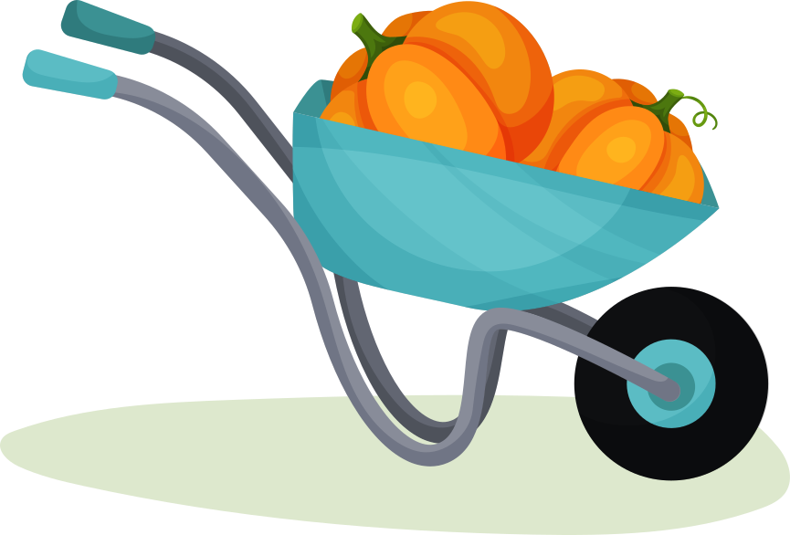

[](https://github.com/johnwalley/allotment/actions/workflows/build.yml)
[](https://www.npmjs.com/package/allotment)
[](https://www.npmjs.com/package/allotment)
[](https://bundlephobia.com/package/allotment)
[](https://www.npmjs.com/package/allotment)
[](https://github.com/johnwalley/allotment/blob/main/LICENSE)

<p align="center">
    <a href="https://github.com/johnwalley/allotment">
    
  </a>

  <h3 align="center">Allotment</h3>

  <p align="center">
    React split-pane component.
  </p>

  <p align="center">
    <a href="https://allotment.mulberryhousesoftware.com/docs/getting-started">Docs</a>
    ·
    <a href="https://allotment.mulberryhousesoftware.com/docs/basic">Examples</a>
    ·
    <a href="https://allotment.mulberryhousesoftware.com/docs/overview">API</a>
    ·
    <a href="./CHANGELOG.md">Changelog</a>
  </p>

  <p align="center">
    
  </p>
</p>

- **React-based:** Integrate effortlessly into your existing React-based application.
- **Industry standard look and feel:** Like VS Code's split view implementation? You're in luck! This component is derived from the same codebase.
- **Dynamic:** Want to declaratively add and remove panes? We've got you covered.
- **Flexible:** Snap panes closed, nest split views, show and hide panes, and persist sizes across reloads.
- **Typed:** Written in TypeScript, with type definitions included.

## Quick start

```sh
npm install allotment
```

Allotment requires React 17, 18 or 19 (`react` and `react-dom` are peer dependencies).

```jsx
import { Allotment } from "allotment";
import "allotment/dist/style.css";

export const App = () => (
  <div style={{ height: 400 }}>
    <Allotment>
      <div>Pane A</div>
      <div>Pane B</div>
    </Allotment>
  </div>
);
```

Allotment fills its parent element, so make sure the parent has a height. See the [FAQ](https://allotment.mulberryhousesoftware.com/docs/faq#its-not-workingi-dont-see-anything) if nothing is showing.

## Documentation

The [documentation](https://allotment.mulberryhousesoftware.com/) has live examples of everything Allotment can do.

- [Getting started](https://allotment.mulberryhousesoftware.com/docs/getting-started)
- Features: [layout](https://allotment.mulberryhousesoftware.com/docs/basic), [sizing](https://allotment.mulberryhousesoftware.com/docs/sizing), [snapping](https://allotment.mulberryhousesoftware.com/docs/snapping), [nesting](https://allotment.mulberryhousesoftware.com/docs/nested), [adding and removing panes](https://allotment.mulberryhousesoftware.com/docs/closable), [visibility](https://allotment.mulberryhousesoftware.com/docs/visible) and [reset and resize](https://allotment.mulberryhousesoftware.com/docs/reset)
- How-to guides: [styling](https://allotment.mulberryhousesoftware.com/docs/styling), [persisting sizes](https://allotment.mulberryhousesoftware.com/docs/persist-sizes) and [server rendering and Next.js](https://allotment.mulberryhousesoftware.com/docs/server-rendering)
- API: [overview](https://allotment.mulberryhousesoftware.com/docs/overview), [`Allotment`](https://allotment.mulberryhousesoftware.com/docs/allotment) and [`Allotment.Pane`](https://allotment.mulberryhousesoftware.com/docs/pane)
- [FAQ](https://allotment.mulberryhousesoftware.com/docs/faq)

## Alternatives

Allotment aims to reproduce the behaviour of VS Code's split view. If you need something different, [react-resizable-panels](https://github.com/bvaughn/react-resizable-panels) is a popular alternative.

## Contributing

Contributions are welcome! See the [contributing guide](./CONTRIBUTING.md) to get started, and please follow the [Code of Conduct](./CODE_OF_CONDUCT.md).

Notable changes are recorded in the [changelog](./CHANGELOG.md).

## License

Allotment is released under the [MIT License](./LICENSE).
